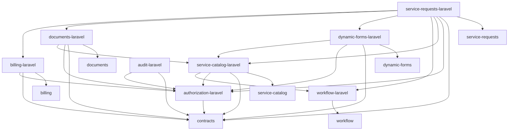

# نقشه وابستگی‌ها و مرزهای استقرار

نمودار زیر وابستگی‌های **مستقیم Composer** میان پکیج‌های داخلی را نشان می‌دهد. `intl/contracts` در مخزن فعلی وجود دارد و در بسته‌های جدید فقط کلاس‌های تکمیلی آن عرضه شده‌اند. فلش `A --> B` یعنی A به B وابسته است.



**کتابخانه‌های خارجی:** `authorization-laravel` از `spatie/laravel-permission:^8.0` و `audit-laravel` از `spatie/laravel-activitylog:^5.1` استفاده می‌کند؛ سایر Laravel Adapterها طبق Manifest بررسی‌شده به اجزای Illuminate 13 وابسته‌اند. نصب کامل نیازمند Composer resolver و افزونه‌های واقعی محیط مقصد است.

**دیاگرام استقرار:**

```text
                 مخزن INTL Platform / Composer Packages
                    (کد و نسخه‌های قابل انتشار)
                         /       |       \
                        /        |        \
               سازمان A      سازمان B       سازمان C
             سرور/شبکه A    سرور/شبکه B     سرور/شبکه C
             DB مستقل A    DB مستقل B     DB مستقل C
                  \           |            /
                   \         |            /
             فقط درخواست‌های پرداخت از طریق API قراردادی
                     سامانه پرداخت مرکزی پیشخوان
```

- هیچ تماس runtime بین دیتابیس سازمان‌ها تعریف نشده است.
- Service Catalog هر مایکروسرویس محلی است؛ Service Discovery مرکزی ایجاد نمی‌شود.
- درخواست‌ها شامل Agency و ServiceRecipient به‌عنوان دو مفهوم جدا هستند؛ ServiceRecipient حساب ورود نیست.
- Workflow تاریخچه تغییر وضعیت، Billing تاریخچه مالی محلی و Spatie Activitylog لاگ گزینشی رویدادها را جداگانه نگه می‌دارند.
- اجزای `service-requests-laravel`، `dynamic-forms-laravel`، `documents-laravel`، `service-catalog-laravel` و `workflow-laravel` هنگام عملیات ایجاد درخواست باید از یک Connection واقعی واحد استفاده کنند.

## ترتیب توپولوژیک نصب (پیشنهادی)

۱. `contracts` موجود → `workflow` → `workflow-laravel` → `authorization-laravel` (اتصال bridge به Workflow بعد از نصب هر دو)

۲. `service-catalog` → `service-catalog-laravel`

۳. `dynamic-forms` → `dynamic-forms-laravel`؛ سپس `documents` → `documents-laravel`

۴. `billing` → `billing-laravel` (بدون فعال‌کردن درگاه عملیاتی)

۵. `service-requests` → `service-requests-laravel`

۶. `audit-laravel` (وابستگی اجرایی به Billing یا Service Requests ندارد؛ پس از آن‌ها صرفاً به دلایل سهولت تست مرحله‌ای نصب شود)

این ترتیب مربوط به Composer و تست Sandbox است؛ زمان اتصال به NCR و راه‌اندازی پرداخت، تصمیم جداگانه می‌خواهد.
